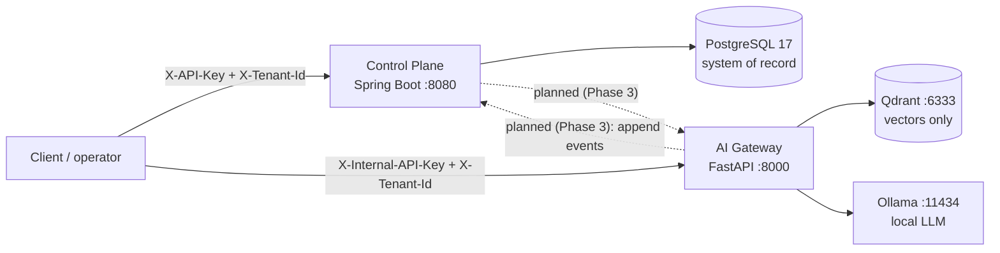

# Orvexa

[](https://github.com/khaddeshivam/Orvexa/actions/workflows/ci.yml)

> Customer-operations backend: a Spring Boot **control plane** that owns tenant-scoped sessions and a
> durable event log, and a FastAPI **AI gateway** that answers questions from tenant documents with
> citations, or abstains when the evidence is weak.

## Status (v0.2.0)

| Component | State | Notes |
|---|---|---|
| Control plane (Spring Boot) | Working | Sessions, lifecycle state machine, idempotent durable event log, API-key auth |
| AI gateway (FastAPI) | Working | Ingest, tenant-scoped retrieval, grounded answers with citations, abstention |
| Control plane <-> gateway integration | **Not built** | Designed in [ADR 0005](docs/decisions/0005-control-plane-ai-gateway-integration.md); next milestone |
| Web console (`apps/web`) | **Placeholder** | A static UI shell. It does not call either API |
| Evals (`evals/`) | **Empty** | Files exist, no questions yet. Retrieval quality is not yet measured |

The two services run and are tested independently. Nothing in this repository claims they are
connected end to end, because they are not yet.

## Architecture



Dotted lines are designed but not implemented. Details, data model and sequence diagrams:
[docs/architecture.md](docs/architecture.md).

**Ownership rules**

- **Spring Boot + PostgreSQL** own business state: sessions, lifecycle, audit events.
- **FastAPI** owns AI orchestration: chunking, embedding, retrieval, prompting, abstention.
- **Qdrant** stores vectors and chunk text only. It is never the system of record.

## Quick start

Prerequisites: Docker Desktop, JDK 21, Maven 3.9+, Python 3.12+ (for tests and the smoke script).

```bash
cp .env.example .env
docker compose up -d                                  # postgres, qdrant, ollama, ai-gateway
docker compose exec ollama ollama pull llama3.2:3b    # one-time model download

cd services/control-plane && mvn spring-boot:run      # control plane on :8080
```

Health checks:

```text
Control plane  http://localhost:8080/actuator/health
AI gateway     http://localhost:8000/health   (liveness)
               http://localhost:8000/ready    (checks Qdrant)
Qdrant         http://localhost:6333/dashboard
```

The first gateway query downloads the embedding model (about 130 MB) into a Docker volume.

### Try the control plane (PowerShell)

```powershell
$tenant = [guid]::NewGuid(); $actor = [guid]::NewGuid()
$h = @{ "X-API-Key"="local-api-key"; "X-Tenant-Id"=$tenant; "X-Actor-Id"=$actor }

$s = Invoke-RestMethod -Method Post -Uri http://localhost:8080/api/v1/sessions -Headers $h `
       -ContentType "application/json" -Body '{"title":"Support conversation"}'
Invoke-RestMethod -Uri "http://localhost:8080/api/v1/sessions/$($s.id)/events" -Headers $h
```

### Try the AI gateway (PowerShell)

```powershell
$h = @{ "X-Internal-API-Key"="local-internal-key"; "X-Tenant-Id"=[guid]::NewGuid() }

Invoke-RestMethod -Method Post -Uri http://localhost:8000/v1/ingest -Headers $h -ContentType "application/json" `
  -Body (@{ title="Refund policy"; documentId="refunds"
            text="Refunds are processed within 5 business days after approval." } | ConvertTo-Json)

Invoke-RestMethod -Method Post -Uri http://localhost:8000/v1/query -Headers $h -ContentType "application/json" `
  -Body '{"question":"How long do refunds take?"}'      # answer + citations

Invoke-RestMethod -Method Post -Uri http://localhost:8000/v1/query -Headers $h -ContentType "application/json" `
  -Body '{"question":"What is the capital of France?"}' # abstained: true, no LLM call
```

Or run the scripted end-to-end check and read the printed scores:

```bash
cd services/ai-gateway && python scripts/smoke.py
```

## API summary

| Service | Endpoint | Purpose |
|---|---|---|
| Control plane | `POST /api/v1/sessions` | Create a session (writes `SESSION_CREATED`) |
| | `GET /api/v1/sessions`, `GET /api/v1/sessions/{id}` | List (paged, by status) and fetch |
| | `PATCH /api/v1/sessions/{id}/status` | Lifecycle transition |
| | `GET /api/v1/sessions/{id}/events` | Ordered event log (paged) |
| | `POST /internal/v1/sessions/{id}/events` | Idempotent append (internal callers) |
| AI gateway | `POST /v1/ingest`, `POST /v1/ingest/file` | Index text or a `.txt`/`.md`/`.pdf` file |
| | `POST /v1/query` | Answer with citations, or abstain |
| | `DELETE /v1/documents/{id}` | Remove a document's chunks |
| | `GET /health`, `GET /ready` | Liveness and readiness |

Contracts: [control-plane.yaml](contracts/openapi/control-plane.yaml),
[ai-gateway.yaml](contracts/openapi/ai-gateway.yaml).

## Repository layout

```text
services/control-plane/   Spring Boot 4 / Java 21: controllers, domain, Flyway migrations, tests
services/ai-gateway/      FastAPI / Python 3.12: RAG pipeline, tests, smoke script, sample docs
apps/web/                 React + Vite UI shell (placeholder)
contracts/openapi/        API contracts for both services
docs/                     Architecture, security, operations, testing, ADRs
evals/                    Evaluation data (empty for now)
docker-compose.yml        Local stack
```

## Design decisions (short version)

- **Postgres is the source of truth.** Event sequencing uses a row lock plus unique constraints, so
  concurrent writers cannot allocate the same sequence number. See the architecture doc.
- **Idempotent writes.** `clientEventId` makes event appends safe to retry; a conflicting replay is a `409`.
- **Abstain before generating.** If no retrieved passage clears the similarity threshold, the gateway
  answers "not enough information" without calling the model.
  ([ADR 0003](docs/decisions/0003-abstain-before-generate.md))
- **Tenant isolation lives in the data layer.** The vector store has no unscoped read or delete path.
  ([ADR 0004](docs/decisions/0004-tenant-isolation-in-data-layer.md))
- **Local-first AI.** Ollama and FastEmbed keep development free of paid APIs.
  ([ADR 0002](docs/decisions/0002-local-first-ai-gateway.md))
- **No premature infrastructure.** No Redis, message broker or Kubernetes until a requirement needs one.

## Testing

```bash
cd services/ai-gateway && pip install -r requirements-dev.txt && pytest   # no Docker or Ollama needed
cd services/control-plane && mvn test                                     # needs Docker (Testcontainers)
cd apps/web && npm ci && npm run build
```

Strategy and what is *not* covered: [docs/testing.md](docs/testing.md).

## Documentation

| Document | What it covers |
|---|---|
| [docs/architecture.md](docs/architecture.md) | Components, data model, flows, concurrency, failure modes, scaling |
| [docs/security.md](docs/security.md) | Trust boundaries, tenant isolation, threat model, known gaps |
| [docs/operations.md](docs/operations.md) | Configuration, runbook, troubleshooting |
| [docs/testing.md](docs/testing.md) | Test strategy, coverage, release checklist |
| [docs/api-design.md](docs/api-design.md) | Control-plane API conventions |
| [docs/decisions/](docs/decisions) | Architecture decision records |
| [CHANGELOG.md](CHANGELOG.md) | Release history |

## Known limitations

1. **Services are not integrated.** A chat message does not yet flow through both services.
2. **No real UI.** `apps/web` is a placeholder shell.
3. **Authentication is development-grade.** Shared API keys, and the tenant is taken from a header
   ([docs/security.md](docs/security.md)). Do not expose these services to untrusted networks.
4. **Retrieval quality is unmeasured.** The similarity threshold (`GATEWAY_MIN_SCORE`, default 0.5) is a
   starting guess and `evals/` is empty.
5. **Synchronous LLM calls.** Each query occupies a worker thread for the duration of generation.
6. **Inconsistent error shapes** between the two services, and the gateway has no correlation IDs yet.
7. **No rate limiting**, and no size limit on internal event payloads.
8. **Changing the embedding model requires reindexing** (the Qdrant collection dimension is fixed).
9. **Naive chunking** (fixed word windows; ignores headings and tables).
10. **Single node**, no backup automation or high availability.

## Roadmap

1. **Phase 3:** control plane <-> gateway integration, with timeouts, bounded retry and a circuit breaker.
2. **Phase 4:** operator console wired to real APIs.
3. **Phase 5:** controlled tool execution with approval and audit.
4. **Phase 6:** evaluation set, tuned threshold, observability, deployment.

## License

No license has been chosen yet. Until one is added, all rights are reserved by the author.
