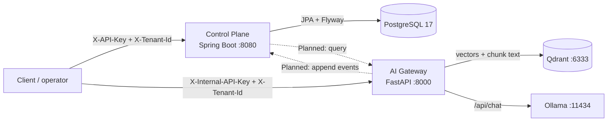
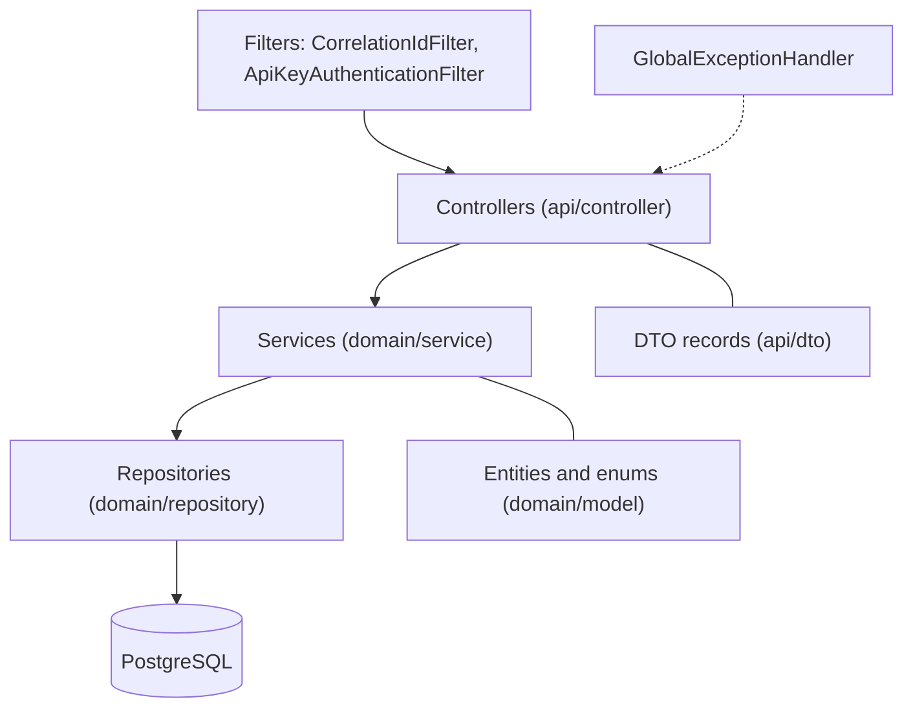
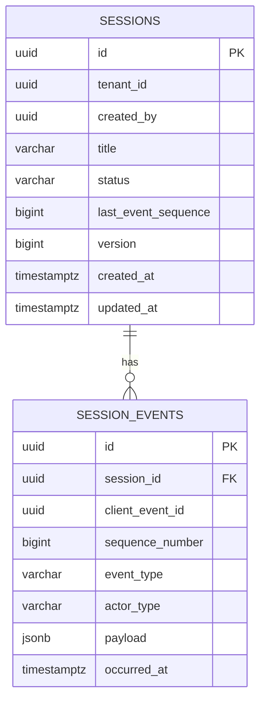
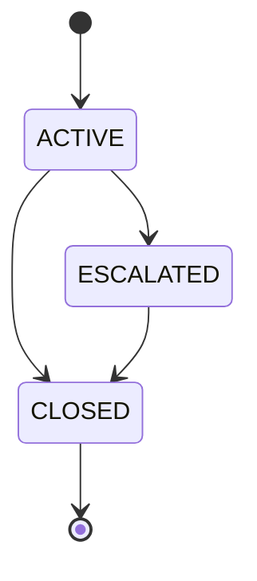
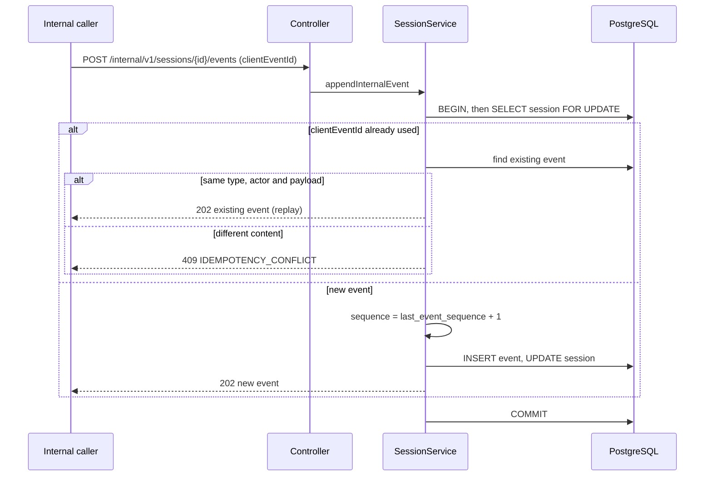
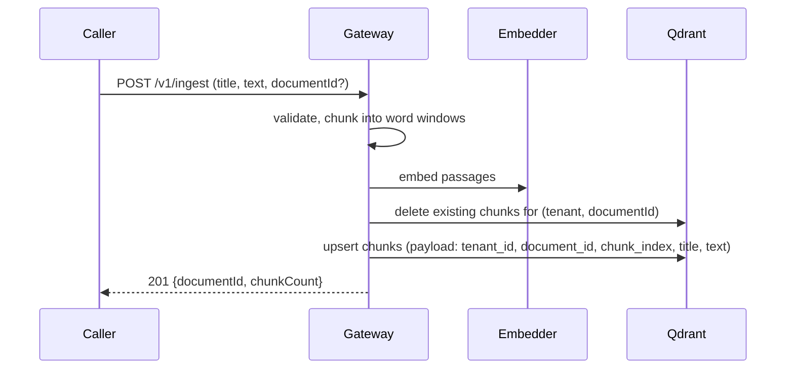
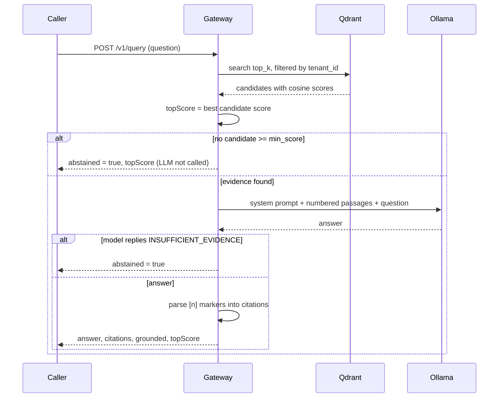
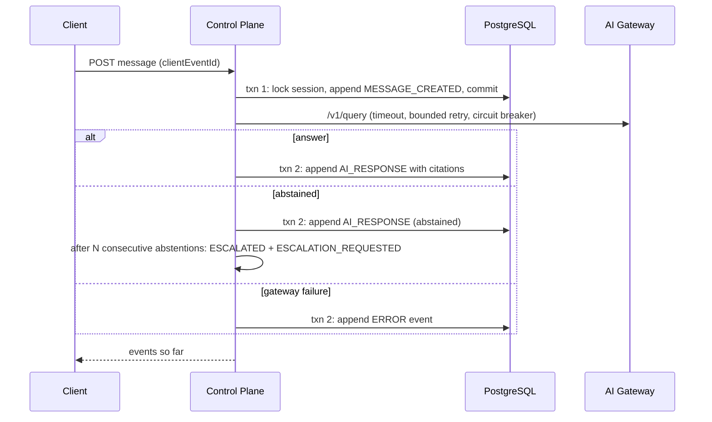
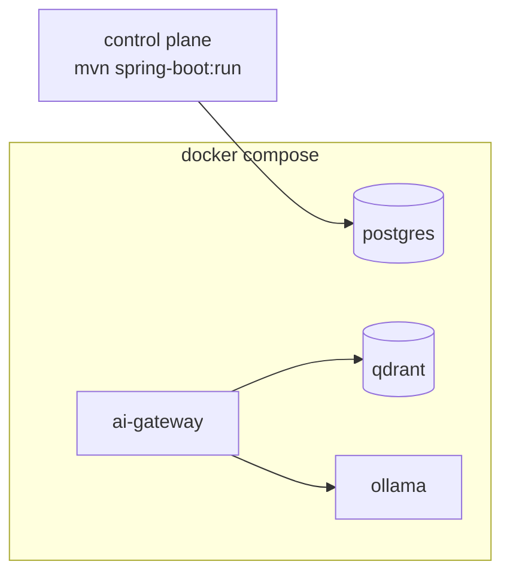

# Orvexa Architecture

Status: describes v0.2.0. Anything not yet built is marked **Planned**.

## 1. Goals and non-goals

**Goals**

- Keep business state (sessions, audit events) durable, ordered and tenant-scoped.
- Answer questions from a tenant's own documents, with citations, and refuse when evidence is weak.
- Keep the AI boundary replaceable: model, embedder and vector store sit behind small interfaces.
- Run the whole stack locally without paid services.

**Non-goals (for now)**

- Production-grade authentication, multi-region deployment, horizontal autoscaling.
- Redis, message brokers, Kubernetes or multi-agent orchestration. Each is added only when a
  measured requirement exists.

## 2. System context

| Component | Technology | Owns |
|---|---|---|
| Control plane | Java 21, Spring Boot 4.1, Spring Data JPA, Flyway | Sessions, lifecycle, event log |
| PostgreSQL | 17 | Durable business state (system of record) |
| AI gateway | Python 3.12, FastAPI, Pydantic | Ingestion, retrieval, prompting, abstention |
| Qdrant | latest image | Chunk vectors and chunk text (derived data) |
| Ollama | `llama3.2:3b` by default | Local text generation |
| FastEmbed | `BAAI/bge-small-en-v1.5` by default | Local embeddings |

**Why two services.** Session and audit logic benefits from a transactional JVM stack; retrieval
and model orchestration benefit from the Python AI ecosystem. The boundary is an HTTP contract
([ADR 0001](decisions/0001-two-service-backend.md)). Qdrant holds derived data and can be rebuilt
from source documents, so only PostgreSQL needs durability guarantees.

## 3. Control plane

### 3.1 Layering

Controllers translate HTTP to service calls and never touch repositories. Services own
transactions. Entities do not leak into responses; DTO records do.

### 3.2 Data model

Constraints that carry correctness (see `V2__create_session_domain.sql`):

- `sessions.status` is checked against `ACTIVE | ESCALATED | CLOSED`.
- `session_events.actor_type` is checked against `USER | SYSTEM | AI | TOOL`.
- `UNIQUE (session_id, client_event_id)` enforces idempotency.
- `UNIQUE (session_id, sequence_number)` guarantees a gap-free, collision-free order per session.
- `event_type` is **not** constrained in SQL; the Java enum is the source of truth. Existing types:
  `SESSION_CREATED`, `SESSION_STATUS_CHANGED`, `MESSAGE_CREATED`, `TOOL_EXECUTION`, `AI_RESPONSE`,
  `ESCALATION_REQUESTED`, `ERROR`. Adding a type needs no migration.

### 3.3 Session lifecycle

A same-state transition is an idempotent no-op. Leaving `CLOSED` is rejected with
`409 INVALID_STATE_TRANSITION`. Every real transition appends a `SESSION_STATUS_CHANGED` event in
the same transaction.

### 3.4 Event append: ordering and idempotency

The row lock serializes writers for one session, so the idempotency lookup and sequence allocation
are atomic. The two unique constraints are a backstop if the lock is ever bypassed. Writers on
*different* sessions do not block each other.

Consequence: **never hold this lock during a slow call.** The planned integration (section 5.4)
is designed around that rule.

### 3.5 Request context and errors

- `X-Correlation-Id` is accepted or generated, placed in the logging MDC, and returned in error bodies.
- External routes: `X-API-Key`, `X-Tenant-Id` (and `X-Actor-Id` on create). Internal routes:
  `X-Internal-API-Key`, `X-Internal-Caller`.
- Error body: `{timestamp, status, code, message, path, correlationId}`. Codes:
  `VALIDATION_ERROR`, `BAD_REQUEST`, `RESOURCE_NOT_FOUND`, `INVALID_STATE_TRANSITION`,
  `IDEMPOTENCY_CONFLICT`, `UNAUTHORIZED`.
- External reads resolve sessions by `(id, tenant_id)`, never by id alone.

## 4. AI gateway

### 4.1 Module map

| Module | Responsibility |
|---|---|
| `main.py` | App factory, auth and tenant dependencies, routes, error handlers |
| `rag.py` | `RagService`: ingest and query orchestration, prompt, citation parsing |
| `chunking.py` | Sliding word window (220 words, 40 overlap by default) |
| `embeddings.py` | `Embedder` interface, FastEmbed adapter, deterministic hash embedder for tests |
| `vectorstore.py` | Qdrant wrapper; every read and delete requires a tenant |
| `llm.py` | `LLMProvider` interface, Ollama adapter, `LLMUnavailableError` |
| `extract.py` | `.txt`, `.md`, `.pdf` text extraction |
| `config.py` | Settings from `GATEWAY_*` environment variables |

Dependencies point inward: `RagService` depends on three interfaces and knows nothing about
FastAPI, Qdrant or Ollama types. That is why the test suite runs with an in-memory Qdrant, a fake
embedder and a fake LLM, with no network.

### 4.2 Ingestion

Chunk point IDs are deterministic (`uuid5(tenant:document:index)`), and prior chunks are deleted
first, so re-ingesting a document replaces it and leaves no orphans.

### 4.3 Query with abstention

Response fields: `answer`, `abstained`, `grounded`, `citations[{ref, documentId, chunkIndex,
title, snippet, score}]`, `topScore`. `grounded = false` means the model produced an answer
without citing any valid passage; callers should treat that as lower confidence.

`topScore` is returned even on abstention because it is the number used to tune `min_score`.

## 5. Cross-cutting concerns

### 5.1 Tenant isolation

| Layer | Mechanism |
|---|---|
| Control plane reads | Repositories resolve by `(id, tenant_id)` |
| Control plane internal append | Looks up by session id only. Trusted caller; see [security.md](security.md) |
| Gateway | Qdrant filter on `tenant_id` for every search and delete; no unscoped method exists |
| Tests | Gateway tests prove tenant B cannot read or delete tenant A's documents |

### 5.2 Failure modes

| Failure | Behavior | Recovery |
|---|---|---|
| Ollama down or model missing | `502 LLM_UNAVAILABLE`; abstention path still works | Start Ollama, `ollama pull` the model |
| Qdrant down | `/ready` returns 503; ingest and query fail | Restore Qdrant; data lives in its volume |
| Qdrant data lost | Retrieval returns nothing, so the gateway abstains | Re-ingest source documents (derived data) |
| PostgreSQL down | Control plane health fails; requests error | Restore the database; this is the system of record |
| Duplicate client retry | Replayed `clientEventId` returns the original event | None needed |
| Concurrent writers, same session | Serialized by row lock | None needed |
| Embedding model changed | Dimension mismatch against the existing collection | Recreate the collection and re-ingest |

### 5.3 Scaling and where it breaks first

1. **Gateway LLM calls are synchronous.** Each `/v1/query` holds a worker thread while the model
   generates; concurrency is bounded by the server thread pool and by Ollama. First fix: async
   endpoints with a bounded concurrency limit and a timeout budget.
2. **Hot sessions.** The row lock serializes appends per session. This is fine for chat-rate
   traffic; a single session receiving thousands of events per second would need a different design.
3. **Event reads** are paged (max 100) and indexed on `(session_id, sequence_number)`.
4. **Qdrant** scales independently of the services; payload indexes exist on `tenant_id` and
   `document_id`.
5. Both services are stateless, so they can run as multiple instances behind a load balancer
   once authentication moves off shared keys.

### 5.4 Planned: control plane to gateway integration (ADR 0005)

**Status: Planned, not implemented.**

Key rule: the gateway call happens **between** two short transactions, never inside one, so the
session row lock is not held during model latency.

## 6. Deployment topology (local)

The control plane has a Dockerfile but is not in `docker-compose.yml`; it runs from Maven during
development. Volumes: `orvexa-postgres-data`, `qdrant-data`, `ollama-data`, `fastembed-models`.
Configuration and runbook: [operations.md](operations.md).

## 7. Technical debt register

| Item | Impact | Suggested fix |
|---|---|---|
| Shared API keys, header-trusted tenant | Not production authz | JWT/OIDC with tenant claim |
| Two different error shapes | Client complexity | Shared error contract in Phase 3 |
| No gateway correlation IDs | Hard cross-service tracing | Propagate `X-Correlation-Id` |
| Unbounded internal event payload | Memory/abuse risk | Size limit and schema per event type |
| Default keys accepted at startup | Easy misconfiguration | Fail fast outside a `dev` profile |
| Empty scaffold packages in the gateway (`api/`, `core/`, ...) | Misleading structure | Use them or delete them |
