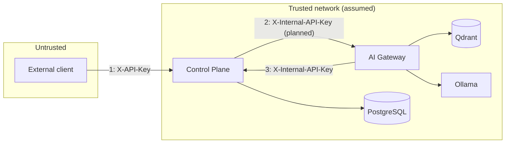

# Security Model

Status: v0.2.0. **This is a development-grade security posture.** It is documented honestly so
nobody mistakes it for production authorization. Do not expose either service to an untrusted network.

## 1. Trust boundaries

| Boundary | Control today | Strength |
|---|---|---|
| Client to control plane | One shared `X-API-Key`; tenant taken from `X-Tenant-Id` | **Weak**: anyone with the key can claim any tenant |
| Service to service | One shared `X-Internal-API-Key` | **Weak**: shared secret, no caller identity |
| Gateway to Qdrant, Ollama, Postgres | Network reachability only | Relies on the private network |

## 2. Authentication

- Control plane: `ApiKeyAuthenticationFilter` selects the expected key by path (`/internal/**` uses the
  internal key, everything else the external key). Comparison is **constant-time**. `/actuator/**` is open.
- Gateway: `X-Internal-API-Key` is compared with `secrets.compare_digest`. `/health` and `/ready` are open
  on purpose and expose no tenant data.
- Keys come from environment variables. The defaults (`local-api-key`, `local-internal-key`) are
  public in this repository and **must be replaced** in any shared environment.

## 3. Tenant isolation

| Where | Guarantee | Enforced by |
|---|---|---|
| Control plane external reads and transitions | A session is only visible under its own tenant | Repository lookups by `(id, tenant_id)` |
| Gateway retrieval and delete | Cross-tenant reads and deletes are impossible through the API | `VectorStore` always applies a `tenant_id` filter; no unscoped method exists |
| Control plane internal event append | **No tenant check**; resolves by session id | Trusted internal callers only |

Limit of the guarantee: the tenant identifier itself is supplied by the caller. Isolation is
correct *given* an honest tenant claim; it does not stop a key holder from claiming another tenant.
Fixing that needs real identity (section 6).

## 4. Input handling

| Input | Limit | Where |
|---|---|---|
| Document text | 500,000 characters | Gateway request model |
| Uploaded file | 10 MB, `.txt` / `.md` / `.markdown` / `.pdf` only | Gateway |
| Question | 2,000 characters | Gateway request model |
| Tenant header | Must parse as a UUID | Both services |
| Session title | 120 characters | Control plane |
| Event payload (`jsonb`) | **No limit** | Control plane internal endpoint (gap) |

SQL access goes through JPA/Spring Data parameter binding; no string-built queries.
PDF parsing uses `pypdf`; treat uploaded PDFs as untrusted input and keep the dependency current.

## 5. Prompt-injection posture (AI gateway)

Retrieved document text is placed in the model prompt, so a malicious document can try to
steer the model. Current mitigations are limited and partial:

- The system prompt restricts answers to numbered passages and requires citations or an explicit refusal.
- Answers carry `grounded`; an uncited answer is flagged rather than trusted.
- The model has **no tools** in this release, so injected instructions cannot trigger actions.

This must be revisited before Phase 5 (tool execution). Tool calls will need an allowlist per
tenant, argument validation and approval for risky actions.

## 6. Known gaps and recommended fixes

| # | Gap | Risk | Recommended fix |
|---|---|---|---|
| 1 | Shared static keys | Key leak exposes everything | JWT/OIDC; per-service credentials |
| 2 | Tenant from a header | Tenant spoofing by any key holder | Tenant derived from a verified token claim |
| 3 | Internal append skips tenant check | A bad internal caller can write to any session | Require tenant on internal calls and verify |
| 4 | No rate limiting | Abuse and cost (LLM) | Gateway and edge rate limits |
| 5 | No payload size limit on events | Memory and storage abuse | Max body size and per-type schema |
| 6 | Default keys work at startup | Accidental insecure deploy | Fail fast outside a dev profile |
| 7 | No TLS in the stack | Credentials on the wire | Terminate TLS at a reverse proxy |
| 8 | No audit of who called the internal API | Weak accountability | Record caller identity on every internal event |
| 9 | No dependency or container scanning in CI | Known-vulnerable libraries | Dependabot and an image scan |
| 10 | AI gateway container runs as root (the control plane image runs as a non-root user) | Larger blast radius | Add a non-root `USER` to the gateway Dockerfile |

## 7. Secrets handling

- Never commit `.env`; `.gitignore` excludes it and keeps `.env.example`.
- `.env.example` contains development placeholders only.
- Rotate any key that has appeared in a screenshot, log or pull request.

## 8. Reporting a vulnerability

Open a private security advisory on the GitHub repository, or contact the maintainer directly.
Please do not file public issues for exploitable findings.
